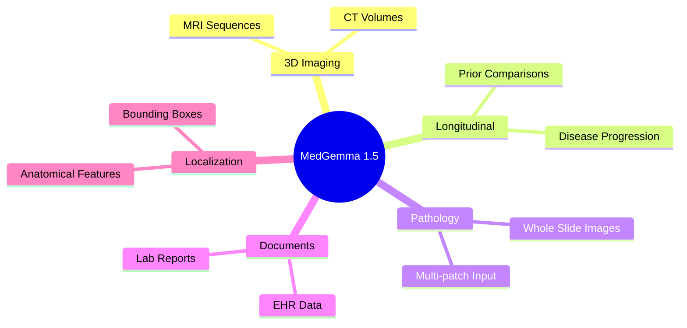
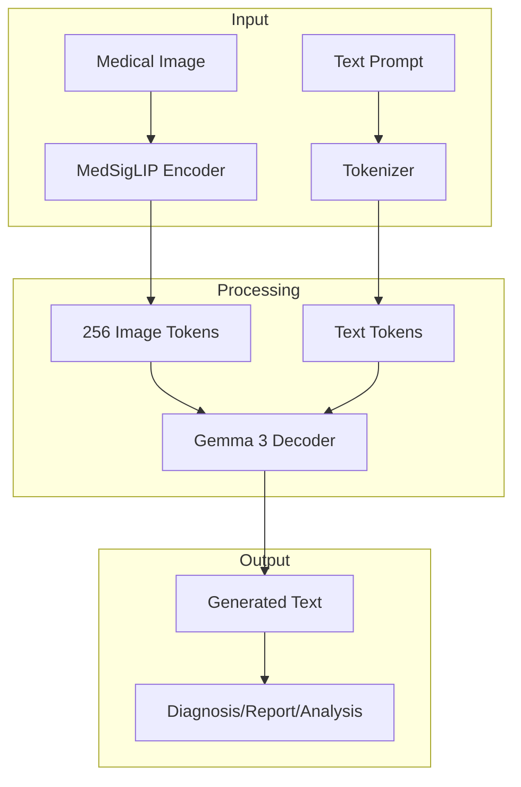
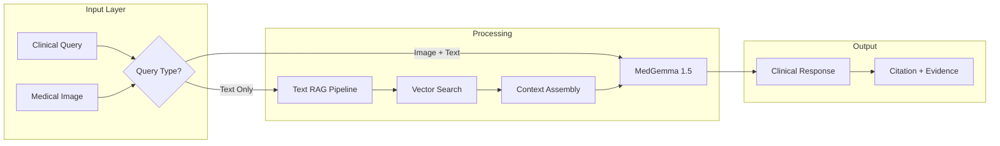
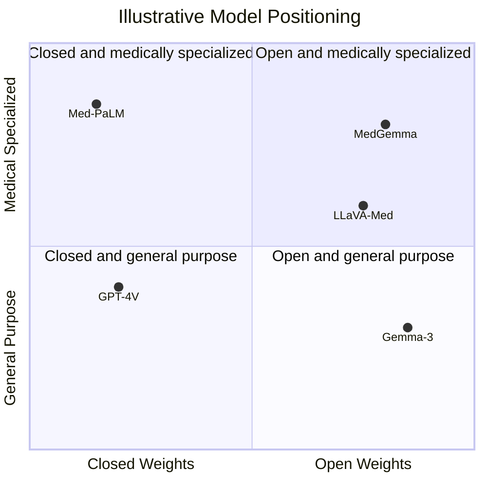

_Editorial update, October 19, 2026: clarified benchmark comparisons and limitations, and added the later MedGemma 1.5 technical report. The January publication date and original perspective are preserved._

Google just dropped MedGemma 1.5, and it's a significant upgrade for anyone building clinical AI systems. As someone who's spent the last two years building production medical AI at Mount Sinai, I want to break down what's actually new and why it matters.

## What's New in 1.5

MedGemma 1.5 isn't just an incremental update. It adds entirely new capabilities:



## Architecture Overview

MedGemma builds on Gemma 3's decoder-only transformer with a specialized medical image encoder:



### Key Specs

| Specification    | Value                         |
| ---------------- | ----------------------------- |
| Parameters       | 4B                            |
| Context Length   | 128K tokens                   |
| Image Resolution | 896 x 896                     |
| Image Tokens     | 256 per image                 |
| Output Length    | 8192 tokens                   |
| Architecture     | Decoder-only Transformer      |
| Attention        | Grouped-Query Attention (GQA) |

## Performance Deep Dive

### Medical Text Reasoning

The results are mixed: MedQA and MedMCQA improve, while PubMedQA and MMLU Med decline relative to MedGemma 1. These are task-specific benchmarks, not evidence of improved clinical outcomes.

```echarts
{
  "title": {
    "text": "Medical QA Benchmarks",
    "left": "center"
  },
  "tooltip": {
    "trigger": "axis"
  },
  "legend": {
    "data": ["Gemma 3 4B", "MedGemma 1 4B", "MedGemma 1.5 4B"],
    "top": "10%"
  },
  "xAxis": {
    "type": "category",
    "data": ["MedQA", "MedMCQA", "PubMedQA", "MMLU Med"]
  },
  "yAxis": {
    "type": "value",
    "name": "Accuracy (%)",
    "min": 0,
    "max": 100
  },
  "series": [
    {
      "name": "Gemma 3 4B",
      "type": "bar",
      "data": [50.7, 45.4, 68.4, 67.2]
    },
    {
      "name": "MedGemma 1 4B",
      "type": "bar",
      "data": [64.4, 55.7, 73.4, 70.0]
    },
    {
      "name": "MedGemma 1.5 4B",
      "type": "bar",
      "data": [69.1, 59.8, 68.2, 69.6]
    }
  ]
}
```

Benchmark source: [Google’s model repository](https://huggingface.co/google/medgemma-1.5-4b-it).

### Imaging Performance

The real story is in the imaging benchmarks. MedGemma 1.5 shows dramatic improvements in 3D imaging and whole-slide pathology:

| Task                               | Gemma 3 4B | MedGemma 1 4B | MedGemma 1.5 4B |
| ---------------------------------- | ---------- | ------------- | --------------- |
| CT Classification (7 conditions)   | 54.5%      | 58.2%         | **61.1%**       |
| MRI Classification (10 conditions) | 51.1%      | 51.3%         | **64.7%**       |
| WSI Pathology (ROUGE)              | 2.3        | 2.2           | **49.4**        |
| EyePACS Fundus                     | 14.4%      | 64.9%         | **76.8%**       |
| Longitudinal CXR                   | 59.0%      | 61.1%         | **65.7%**       |

WSI uses ROUGE, while the other rows report task-specific classification accuracy; these metrics are not interchangeable. CT and MRI use internal benchmark datasets, and longitudinal CXR uses MS-CXR-T. The jump from 2.2 to 49.4 ROUGE on whole-slide pathology is remarkable. [Benchmark definitions and results](https://huggingface.co/google/medgemma-1.5-4b-it).

## Quick Start Code

Here's how to get started with the pipeline API:

```python
from transformers import pipeline
from PIL import Image
import requests
import torch

# Initialize the pipeline
pipe = pipeline(
    "image-text-to-text",
    model="google/medgemma-1.5-4b-it",
    torch_dtype=torch.bfloat16,
    device="cuda",
)

# Load a chest X-ray
image_url = "https://upload.wikimedia.org/wikipedia/commons/c/c8/Chest_Xray_PA_3-8-2010.png"
image = Image.open(
    requests.get(image_url, headers={"User-Agent": "example"}, stream=True).raw
)

# Create the prompt
messages = [
    {
        "role": "user",
        "content": [
            {"type": "image", "image": image},
            {"type": "text", "text": "Describe this X-ray"}
        ]
    }
]

# Generate
output = pipe(text=messages, max_new_tokens=2000)
print(output[0]["generated_text"][-1]["content"])
```

The example image is by Stillwaterising (CC0), via [Wikimedia Commons](https://commons.wikimedia.org/wiki/File:Chest_Xray_PA_3-8-2010.png). See Google’s [model repository](https://huggingface.co/google/medgemma-1.5-4b-it) for model-access and installation prerequisites.

Or, using the `messages` defined above, call the model directly for more control:

```python
from transformers import AutoProcessor, AutoModelForImageTextToText
import torch

model_id = "google/medgemma-1.5-4b-it"

model = AutoModelForImageTextToText.from_pretrained(
    model_id,
    torch_dtype=torch.bfloat16,
    device_map="auto",
)
processor = AutoProcessor.from_pretrained(model_id)

# Process inputs
inputs = processor.apply_chat_template(
    messages,
    add_generation_prompt=True,
    tokenize=True,
    return_dict=True,
    return_tensors="pt"
).to(model.device, dtype=torch.bfloat16)

# Generate with control over parameters
with torch.inference_mode():
    generation = model.generate(
        **inputs,
        max_new_tokens=2000,
        do_sample=False
    )

# Decode only newly generated tokens
continuation = generation[0, inputs["input_ids"].shape[-1]:]
print(processor.decode(continuation, skip_special_tokens=True))
```

## Integration Architecture

Here's how I'm thinking about integrating MedGemma into a clinical RAG system:



## What This Means for Clinical AI

### The Good

1. **Open weights** - Unlike GPT-4V or Med-PaLM, you can actually run this locally
2. **4B parameters** - Fits on a single GPU, practical for production
3. **3D imaging support** - CT/MRI interpretation was a major gap
4. **EHR understanding** - Finally, a model that can parse clinical notes

### The Limitations

> **Important**: MedGemma is not intended for direct clinical use. All outputs require independent verification.

- Longitudinal and volumetric benchmarks are reported; arbitrary multi-image clinical workflows still require task-specific evaluation. See the [official launch article](https://research.google/blog/next-generation-medical-image-interpretation-with-medgemma-15-and-medical-speech-to-text-with-medasr/) and [model card](https://developers.google.com/health-ai-developer-foundations/medgemma/model-card).
- Not optimized for multi-turn conversations
- Prompt-sensitive (more than base Gemma)
- English-only evaluation

## Comparison with Alternatives

This is an illustrative positioning diagram, reflecting my view rather than measured scores or deployment readiness.



## Next Steps

I'm planning to:

1. **Benchmark against our RAG system** - How does MedGemma compare to Mistral-7B for clinical QA?
2. **Test 3D imaging** - We have CT data from the MMAP pipeline
3. **Fine-tune for hematology** - Our OncoCITE system could benefit from better image understanding

## Resources

- [Model on Hugging Face](https://huggingface.co/google/medgemma-1.5-4b-it)
- [Original MedGemma technical report](https://arxiv.org/abs/2507.05201)
- [MedGemma 1.5 technical report — April 2026](https://arxiv.org/abs/2604.05081)
- [Tutorial Notebooks](https://github.com/Google-Health/medgemma)

---

_What are you building with MedGemma? I'd love to hear about your use cases in the comments below._
